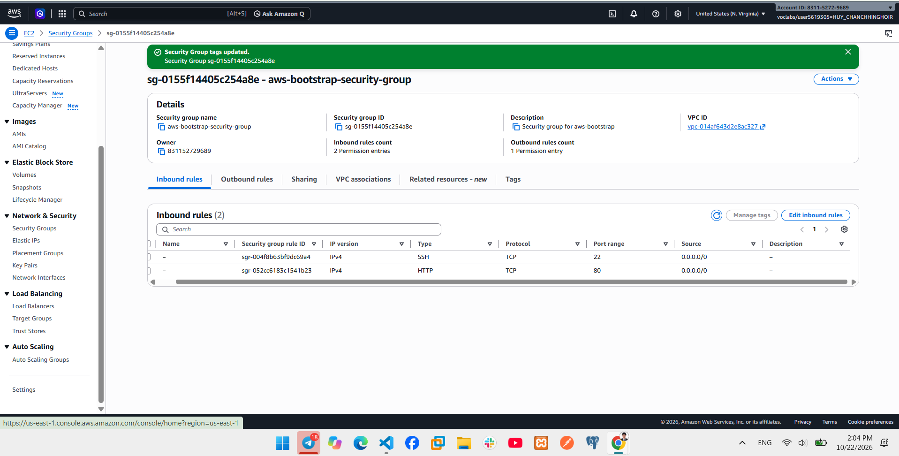
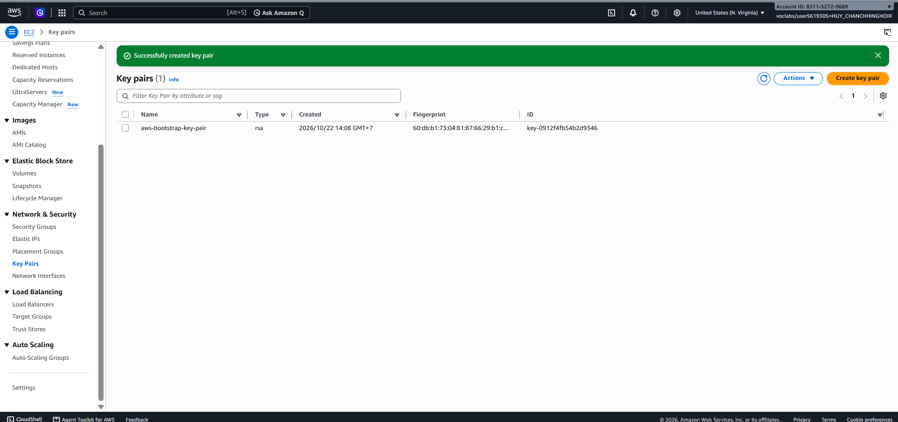
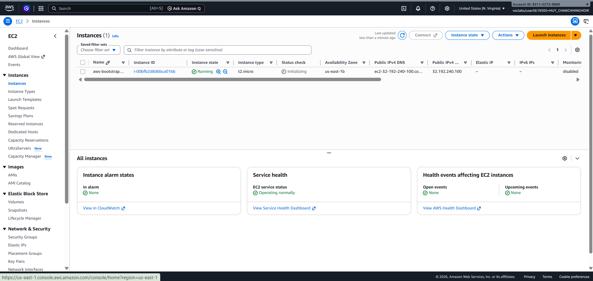
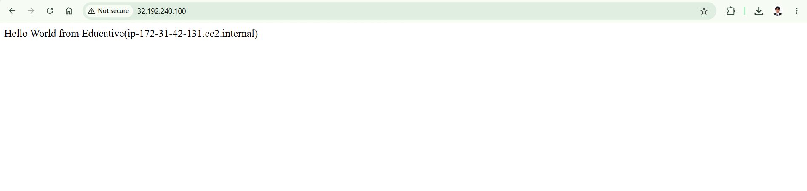
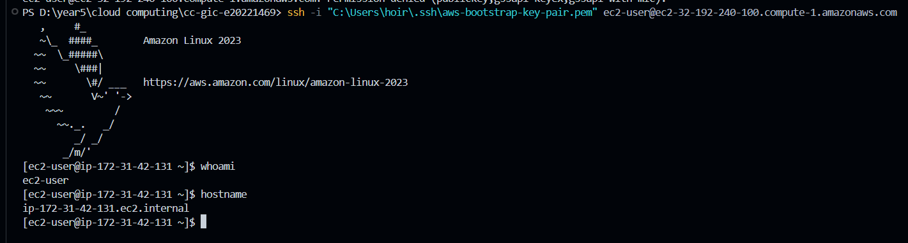
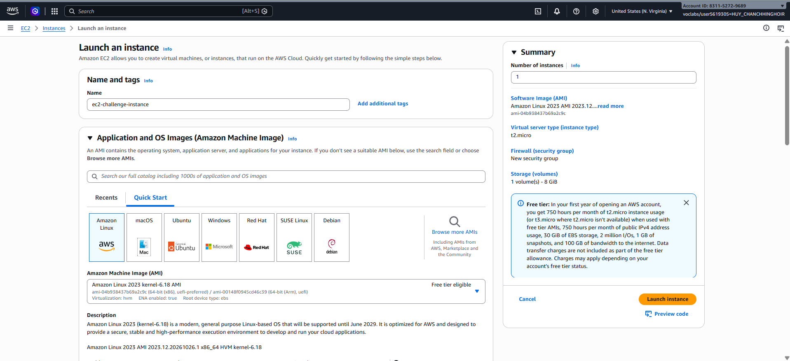
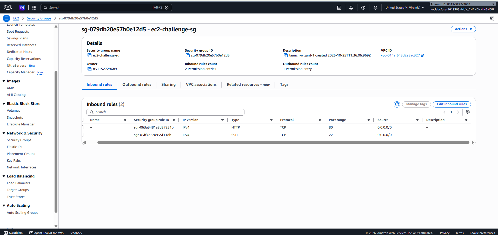
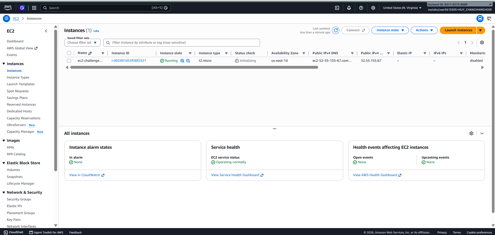
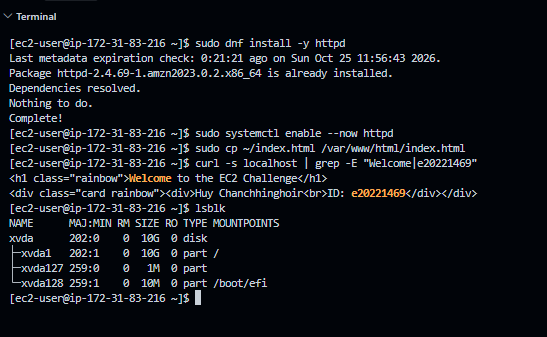
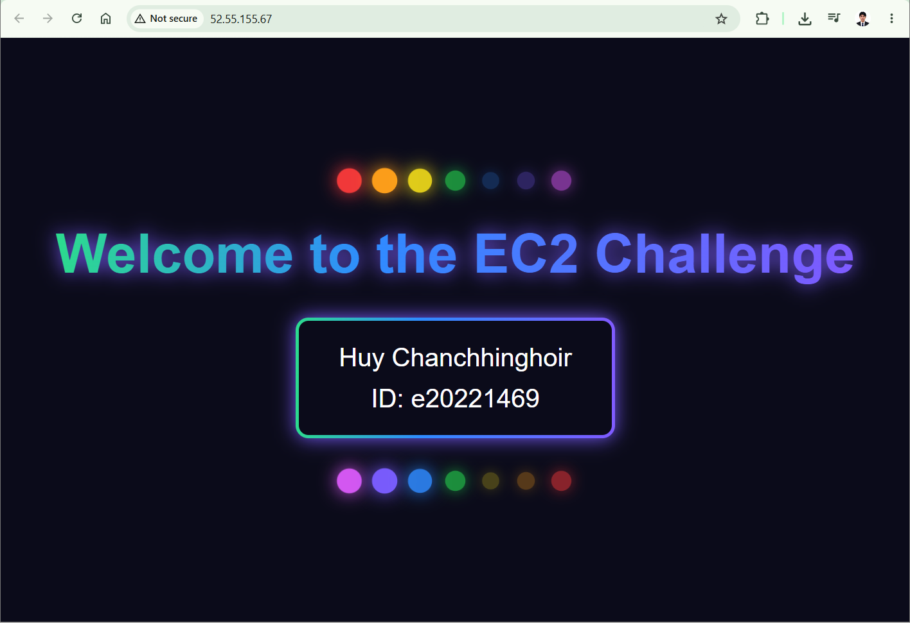

# Cloud Lab 1 Submission — Amazon EC2

Lab instructions: [lab1-instruction.md](https://github.com/RathpiseyAlpha/ITC-I5GIC-CC/blob/main/labs/lab1/lab1-instruction.md)

- **Student name:** Huy Chanchhinghoir
- **Student ID:** e20221469
- **Learner Lab user name:** voclabs/user5619305=HUY_CHANCHHINGHOIR
- **Date completed:** 2026-10-25

---

## Part 1.1 — An Amazon EC2 Walkthrough

### Security group



### Key pair



### Instance details



### Browser test



### SSH connection



Did you connect with your own SSH client or with EC2 Instance Connect?

I connected with my own SSH client (OpenSSH in PowerShell on Windows), using the private key `aws-bootstrap-key-pair.pem` and the instance's public IPv4 DNS `ec2-32-192-240-100.compute-1.amazonaws.com`.

---

## Part 1.2 — EC2 Web Solution (Challenge)

### Launch configuration



| Setting | Value |
| --- | --- |
| Name | `ec2-challenge-instance` |
| AMI | Amazon Linux 2023 (64-bit x86) |
| Instance type | `t2.micro` |
| Key pair | `ec2-challenge-key` (RSA, `.pem`) |
| Public IP | Auto-assigned: `52.55.155.67` |
| Security group | `ec2-challenge-sg`: SSH (22) and HTTP (80) from `0.0.0.0/0` |
| Root volume | 10 GiB gp3 |

### Security group



### Running instance



### Commands on the instance



Paste the commands you ran to install the web server and create `index.html`:

```bash
# Connect from Windows PowerShell
ssh -i "$HOME\.ssh\ec2-challenge-key.pem" ec2-user@52.55.155.67

# Install and start the Apache web server
sudo dnf install -y httpd
sudo systemctl start httpd
sudo systemctl enable httpd

# First test page
echo "<h1>Welcome to the EC2 Challenge</h1>" | sudo tee /var/www/html/index.html

# Final page: index.html (content below) copied from my PC, in Windows PowerShell
scp -i "$HOME\.ssh\ec2-challenge-key.pem" index.html ec2-user@52.55.155.67:/home/ec2-user/index.html

# On the instance: put it in the web root
sudo cp ~/index.html /var/www/html/index.html

# Check the page and the disk size
curl -s localhost | grep -E "Welcome|e20221469"
lsblk
```

Content of the final `index.html` (an animated page: 7-colour rainbow title, a glowing card with my name and ID, and blinking lights). I first created it on the instance with this `tee` heredoc. In the screenshot I copied the same file into place with `sudo cp`:

```bash
sudo tee /var/www/html/index.html > /dev/null <<'EOF'
<!DOCTYPE html>
<html lang="en">
<head>
<meta charset="utf-8">
<meta name="viewport" content="width=device-width, initial-scale=1">
<title>EC2 Challenge</title>
<style>
:root{--r:#ff3b3b;--o:#ff9f1a;--y:#ffe81a;--g:#2bff5a;--b:#2f8bff;--i:#7a5cff;--v:#e05cff}
body{margin:0;min-height:100vh;display:flex;flex-direction:column;align-items:center;justify-content:center;gap:40px;background:#0b0b1a;color:#fff;font-family:Arial,sans-serif;text-align:center}
.rainbow{background-image:linear-gradient(90deg,var(--r),var(--o),var(--y),var(--g),var(--b),var(--i),var(--v),var(--r));background-size:400% 100%;animation:move 4s linear infinite,glow 7s linear infinite}
h1{font-size:clamp(2em,6vw,4em);margin:0 20px;-webkit-background-clip:text;background-clip:text;color:transparent}
.card{padding:4px;border-radius:16px}
.card div{background:#0b0b1a;border-radius:12px;padding:20px 50px;font-size:1.6em;line-height:1.6}
.lights{display:flex;gap:18px}
.lights i{width:26px;height:26px;border-radius:50%;background:var(--c);box-shadow:0 0 20px var(--c);animation:blink 1.4s infinite;animation-delay:calc(var(--n) * .2s)}
@keyframes move{to{background-position:400% 0}}
@keyframes glow{0%,100%{filter:drop-shadow(0 0 12px var(--r))}14%{filter:drop-shadow(0 0 12px var(--o))}28%{filter:drop-shadow(0 0 12px var(--y))}42%{filter:drop-shadow(0 0 12px var(--g))}57%{filter:drop-shadow(0 0 12px var(--b))}71%{filter:drop-shadow(0 0 12px var(--i))}85%{filter:drop-shadow(0 0 12px var(--v))}}
@keyframes blink{0%,100%{opacity:.25;transform:scale(.8)}50%{opacity:1;transform:scale(1.2)}}
</style>
</head>
<body>
<div class="lights"><i style="--c:var(--r);--n:0"></i><i style="--c:var(--o);--n:1"></i><i style="--c:var(--y);--n:2"></i><i style="--c:var(--g);--n:3"></i><i style="--c:var(--b);--n:4"></i><i style="--c:var(--i);--n:5"></i><i style="--c:var(--v);--n:6"></i></div>
<h1 class="rainbow">Welcome to the EC2 Challenge</h1>
<div class="card rainbow"><div>Huy Chanchhinghoir<br>ID: e20221469</div></div>
<div class="lights"><i style="--c:var(--v);--n:0"></i><i style="--c:var(--i);--n:1"></i><i style="--c:var(--b);--n:2"></i><i style="--c:var(--g);--n:3"></i><i style="--c:var(--y);--n:4"></i><i style="--c:var(--o);--n:5"></i><i style="--c:var(--r);--n:6"></i></div>
</body>
</html>
EOF
```

### Browser test



---

## Questions

1. Your security group has an SSH rule and an HTTP rule. What does each one let you do? What would stop working if you deleted the HTTP rule?
2. In Part 1.1 you never logged in to install the web server. What installed it, and when did it run?
3. Why does the web page open with `http://` but not with `https://`?
4. Part 1.2 asked for a 10 GiB root volume. Where in the launch settings did you set it, and how can you check the size on the running instance?

### Answers

1. The **SSH rule** (TCP port 22) lets me log in to the instance remotely with an SSH client or EC2 Instance Connect, so I can run commands and configure it. The **HTTP rule** (TCP port 80) lets browsers on the internet request the web page from the web server. If I deleted the HTTP rule, the page would no longer open from my browser: the security group would drop the request and the browser would time out. SSH would still work, and `curl localhost` on the instance would still show the page, because that request never passes through the security group.
2. The **user data script** installed it. EC2 runs the user data script once, as root, the first time the instance boots (through cloud-init). It ran during the launch, before I connected. It updated the packages, installed `httpd`, started and enabled the service, and wrote `index.html`.
3. Apache only listens on **port 80 (HTTP)**. HTTPS uses port 443 and needs TLS (`mod_ssl` and a certificate), which I never set up. The security group also has no rule for port 443, so an `https://` request is blocked and times out.
4. I set it in the **Configure storage** section of the launch wizard by changing the root volume (gp3) from 8 to **10 GiB**. On the running instance, `lsblk` shows `xvda 10G` (in my screenshot), and `df -h /` shows the root file system size. In the console it is under the instance's **Storage** tab, on the attached EBS volume.

## Problems and how I solved them (optional)

- **I deleted the challenge key pair in the console before connecting.** SSH still worked: EC2 copies the public key into the instance (`~/.ssh/authorized_keys`) at launch, so deleting the key pair in AWS does not affect an instance that is already running. I only needed the `.pem` file on my computer.
- **Pasting the long `index.html` block made some lines look garbled in the VS Code terminal.** This was only a display problem. I checked that the file was correct by running `curl -s localhost | grep -E "Welcome|e20221469"` on the instance and by opening the page in the browser.

## Clean up

- [x] Part 1.1: instance terminated, key pair and security group deleted.
- [x] Part 1.2: instance terminated, security group (and key pair, if any) deleted.
